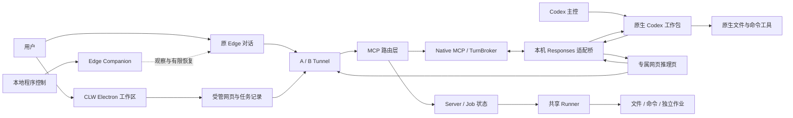

# CLW：一次 Agent Harness 工程复盘

2026-10-28。面向理解系统、后续取舍和技术面试。代码基线为 `5be3a09`，本次只做源码与已有证据复核，没有向模型发测试消息，也没有操作现役网页、AB 或 Runner。

## 1. 这属于什么开发

**属于 agent harness 开发，同时包含桌面应用、浏览器自动化和分布式系统集成。** Harness 是模型外围让任务能够执行的环境：准备上下文、提供工具、运行循环、保存进展、处理等待与失败。它不是模型训练，也不等于写一段系统提示词。Anthropic 的长任务 harness 文章同样把跨会话进展、环境准备和可交接产物当作工程问题；这不是一个要求所有产品采用相同架构的标准。[参考](https://www.anthropic.com/engineering/effective-harnesses-for-long-running-agents)

CLW 的特殊难点是：把原本供人操作的网页模型接入机器执行循环，同时保留人随时手动操作的能力。Codex 和部分网页适配器来自上游，CLW 做的是集成、适配、状态管理与恢复，不应把整个执行内核说成从零自研。

项目的价值需要分开判断：

- 对已经熟练使用 Edge 的用户，重做聊天壳的新增价值较小；登录、设置和任务概念反而增加维护成本。
- 把网页推理接入原生工具、让多个工作包有可查询的身份和结果，仍有实际技术价值。
- 技术能力存在，不代表它已经达到“长期无人看管且稳定”的产品要求。近期真实工作仍有页面故障，不能用测试总数替代这个事实。

## 2. 三条路线，不是一个简单聊天窗口

**纯 Web＋Local-MCP：**网页模型通过 MCP 请求本地文件和命令。A/B 是连接身份，底层共享执行环境；12 个网页对话不意味着 12 个本地命令持续并行。

**Codex＋Web：**原生 Codex 保留工具和执行身份，本机桥把模型请求交给网页推理。专属网页仍通过 Tunnel→MCP路由层→Native MCP／TurnBroker 请求原生工具，桥把这些调用送回 Codex；这条原生工具分支不经共享Runner。一个工作包可以跨很多次网页请求，所以每次菜单读取、发送、观察、结果关联都可能成为故障点。

**Edge Companion：**在原 Edge 对话上观察公开状态、处理已配置确认、恢复明确故障。它不等于 Runner，也不能因为本地工具在线就断言网页模型健康。

| 代码入口 | 核心职责 |
|---|---|
| [web-host/main.cjs](../apps/web-host/main.cjs)、[task-submission.cjs](../apps/web-host/task-submission.cjs) | Electron 工作区、账号页面、先保存意图再发送 |
| [harness_managed_stdio.py](../scripts/harness_managed_stdio.py) | UI 与持久任务状态之间的命令通道 |
| [start_codex_web.ps1](../scripts/start_codex_web.ps1) | 原生 Codex 的账号、模型、工作目录和输出入口 |
| [ChatGPT adapter](../apps/codex-web-bridge/upstream/src/adapters/chatgpt-web/index.ts) | 网页推理与原生工具调用之间的协议适配 |
| [browser-worker.ts](../apps/codex-web-bridge/upstream/src/adapters/chatgpt-web/browser-worker.ts) | 页面、发送、模型控件及可见错误的处理 |
| [public-listener.cjs](../apps/codex-web-bridge/public-listener.cjs)、[serve.ts](../apps/codex-web-bridge/serve.ts) | 对外 socket 与长期持有工作状态的 owner 分离 |
| [native_work_admission.py](../scripts/native_work_admission.py) | 工作包准入、写域冲突、排队和结清 |
| [web_companion_control.py](../scripts/web_companion_control.py)、[local-control.js](../apps/web-recovery-companion/local-control.js) | 本地程序与原 Edge 标签的控制及回执 |
| [Native source](../vendor/native-runtime/README.md) | Rust Server／Runner／CLI 原始源码、增量补丁及许可 |

## 3. 为什么会不稳定

### 3.1 把用户界面当作机器协议

正式 API 通常有结构化字段、请求身份和明确错误。网页界面由 DOM、可见性、异步渲染、菜单状态和文案共同表达状态；这些并不是稳定的机器协议。

一个具体故障是 `Invalid conversation body`：页面的 `textContent` 把错误与相邻按钮拼成 `Invalid conversation body重试`。旧匹配要求错误后有空白或文本结束，因此漏判。修复改为可见告警识别，并只允许原 URL 有界刷新；没有因此证明平台为什么产生这条错误。[实现](../apps/codex-web-bridge/upstream/src/adapters/chatgpt-web/browser-worker.ts)

另一个故障是“模型强度菜单未打开”。原工作包在发送前失败；后来在留存页用同一函数打开、读取并关闭菜单却成功。**这是瞬时故障的证据，不是永久修复的证据**。没有足够数据把它归因于某个特定网页渲染竞态。

工程含义：应把网页差异压在窄适配层里，用录制或构造的 DOM 场景测试，再做少量真实页面核验。再写十条“不要退出”的提示词，不能修复菜单打不开或 DOM 识别错误。

长任务还会累积失败机会。仅作数学示例：若50个必经步骤各自成功率99%、彼此独立且没有恢复，全部成功的概率是 `0.99^50 ≈ 60.5%`。这不是CLW的实测成功率，实际故障也未必独立；它说明应减少脆弱步骤并让局部失败可恢复，而不是只要求模型工作更久。

### 3.2 心跳活着，执行却可能堵住

Runner 归档补丁显示，项目扫描曾占用与连接活性相关的执行路径。修复把扫描移入 `spawn_blocking`，保持扫描单实例，并按会话／版本丢弃过期结果；另为 WebSocket 入站静默和发送等待设置上限。[扫描补丁](../vendor/native-runtime/patches/0002-fix-runner-keep-heartbeat-responsive-during-project-.patch)、[传输补丁](../vendor/native-runtime/patches/0001-fix-bound-runner-websocket-silence-and-clarify-trans.patch)

这叫**头部阻塞与控制路径隔离**：如果负责维持连接的小工作被大量文件扫描拖住，用户看到的是“连接丢了”，真实问题却可能是本地调度。给网页刷新或换一个 Runner 名字，未必解决这个机制。

健康至少分四层：进程存在 → 连接新鲜 → 真实请求有响应 → 任务得到可验收结果。前一层不能替代后一层；健康探针也不能频繁到抢占实际任务。

### 3.3 多处状态都在试图回答“完成了吗”

网页停止生成、原生 turn 结束、工具进程退出、Job 终态、结果回收、Goal 交付是不同事件。CLW 同时要处理它们，又要兼容 CLI 协议变化，因此出现了任务已停止但 claim 未释放、旧未知记录阻止退出等问题。

`native-terminal-receipt.cjs` 和准入逻辑中的终态兼容、精确取消与结清体现了这一负担。[终态适配](../apps/codex-web-bridge/native-terminal-receipt.cjs)、[取消](../scripts/native_work_cancellation.py)、[准入与结清](../scripts/native_work_admission.py)

工程含义是**事实的唯一归属**：工具是否结束由执行器回答；消息是否送达由发送回执回答；用户目标是否完成由成果验收回答。界面展示这些事实的组合，不应再创造一个与它们竞争的“完成”。

这里的保守检查有合理目的，但失败后的出口必须具体：谁还在运行、哪份证据缺失、如何查询原操作或定向取消。只有“需要处理”而没有可执行的下一步，就把正确性要求变成了用户无法解决的死锁。

### 3.4 重试不是越多越可靠

考虑：发送已经成功，但回执在途中丢了。此时重复发送，会启动第二轮工作；直接报失败，也可能把仍在工作的任务丢掉。

CLW 的一个正确设计是**先记意图和操作 ID，再执行；结果未知时查询原 ID**。Companion 的 `unknown/claimed` 回执与本地任务身份就服务于这个目的。[本地领取点](../scripts/web_companion_control.py)、[扩展动作前记录](../apps/web-recovery-companion/local-control.js)

这与幂等接口的思路一致：相同请求身份应表示同一次意图，而不是每次超时都制造新任务。[AWS 工程说明](https://aws.amazon.com/builders-library/making-retries-safe-with-idempotent-APIs/)

但网页发送没有由 CLW 控制的服务端幂等键，所以不能承诺端到端 exactly-once。实际可实现的是：本地去重、查询原操作、核对页面，无法判定时明确保留未知。恢复也应区分未发送、已发送未回执、执行中和已完成，不能共用一个“重试”按钮。

### 3.5 并行带来共享资源竞争，不只是多开页面

16 是本地作业槽位上限，不是 Pro 的额度，也不是“最多只能有16个对话”。一个网页可能没有本地作业，也可能一次发出多个。排队是承载能力与资源互斥的结果，通常比无限并发更可控。

同仓库 Git 元数据、重叠写路径及 Unity/GPU 等资源不能随意并发。`GitReadOnly` 让明确不写 Git 且写域不重叠的包并行；它是协作声明，不是文件系统沙箱。[冲突判定](../scripts/native_work_admission.py)

Companion 当前逐条消费 peer 命令；串行降低页面竞争，但一个慢步骤会延迟后续控制。这是源码支持的潜在吞吐限制，尚不能据此认定它导致了每次网页断连。改进应先限定每步耗时、按标签隔离，再考虑增加并行，而不是同时点击所有页面。

### 3.6 补丁存在，不等于正在使用它

Python、CJS、TypeScript、Rust、Electron 和浏览器扩展都有自己的进程生命周期。源码提交、helper 构建、文件安装、进程实际装载、真实工作通过，是五个不同检查点。

近期修复中，已构建 helper 只对后续加载生效；运行中的旧 helper 没有因 Git 提交自动更新。为了加载修复而重启共享服务，又可能打断其他对话。版本身份和局部更新边界因此是可靠性问题，不只是打包细节。

本轮开源检查又找到一个可复现例子：开发目录中的两份 `markdown-it-texmath` 文件符合上游固定哈希，但旧Git归档把CRLF换成了LF，干净导出后的发行检查失败。随后按原哈希恢复Git中的原始字节，没有改运行中的文件或上游哈希。另有发行测试依赖未构建的helper和已安装依赖，需明确标为有前提的集成检查。这正说明“我的开发目录能过”与“别人从Git取得的源码能重建”不是同一件事。

## 4. 观测说明了什么

本次复读了 2026-10-24 的原八小时采集结果和汇总，公开只保留[去除实例身份的数值摘要](architecture/pressure-observation-20261024.json)。没有重新运行压力测试。

| 项目 | 原观察结果及边界 |
|---|---|
| 覆盖 | 28,800.015 秒；1,920 个样本；475 次 runtime 探测 |
| 负载 | 用户报告12个 A-Pro 对话；125/475 次探测有本地活跃作业，**不是8小时持续12路满载** |
| 本地并发 | 峰值16；4次探测看到满槽；排队峰值7，3段排队共4次采样，后续探测均清空 |
| 连接 | A 轮询错误计数本轮增加1，B增加0；Watch 未记录不健康样本，Runner心跳年龄最大30秒 |
| Runner 资源 | 整机归一化 CPU 峰值2.51%；私有内存约9.8→10.6 MiB，峰值16.9 MiB |
| 其他资源 | Server私有内存约74.4→125.9 MiB；Union峰值约615.5 MiB，末值约455.9 MiB；不能只看Runner |
| 响应 | runtime探测P95为32ms，最大1234ms；这是本地状态读取，**不是模型回复延迟** |

这组数据不支持“单 Runner 长期 CPU 或内存耗尽导致全部不稳定”的判断；也不能证明每条网页对话都健康。状态探测之间可能存在短故障，公开网页流、个别请求、模型平台端并不都被该观察覆盖。Server内存增长值得用更长同负载曲线区分缓存与泄漏，仅凭首尾值不能定性。

## 5. 最值得反思的设计选择

**第一，用户问题很小，系统覆盖面却不断扩大。** 最初是代替复制提示词、处理确认和接续；后来同时承担聊天壳、协作分派、Goal、跨设备安装、权限管理、网页恢复和原生桥。每项单独合理，但每增加一种“拥有任务状态”的组件，就增加协调与故障组合。

**第二，把长时间不退出当成质量目标，会偏离真正目标。** 有价值的指标是可推进工作完成率、用户干预次数、重复执行率、原工作恢复时间和成果可验收性。长思考可以是正常等待，也可以是卡死；不能单凭时长判断。

**第三，测试数量不是任务成功率。** 单元测试善于验证明确合同，不容易预测真实网页下一次怎么变。应分别报告状态机测试、真实工具闭环、持续观察和用户交付；一个渠道通过不为另一个背书。

**第四，权限开放与可靠性是两个维度。** 合法的常规确认可以自动处理，但无法修复网络、进程阻塞、页面失效或重复提交。开放目录也不应该顺带让软件自动恢复旧业务。用户控制权需要清楚的动作语义，不需要遍地阻挡。

**第五，应更早承认路线的可靠性上限。** 对机器自动化而言，网页只是可观察、可操作的外部界面，无法控制平台内部任务状态。专门 API 通常更容易建立结构化合同，但成本、能力和权限与网页订阅不同，不能偷偷换路线；要作为明确产品取舍讨论。

## 6. 如果重做，怎样保持轻量

不是现在再重写一个框架。若继续投入，推荐围绕已有部件缩成三个边界：

1. **一份任务与操作账本。** 原任务、原操作、发送状态、工具状态、结果引用各有唯一来源；UI只是投影。
2. **两个窄适配器。** 网页适配器只观察/发送/确认/定向停止；执行适配器只提交/查询/取消原Job。协议变化在边界吸收。
3. **一个有界恢复器。** 依据失败类别处理原操作，使用程序计时和事件等待；正常长任务不催促，未知结果不重放，某页坏了不重启所有页。

保留持久身份、原回执、独立Job、并发准入与人工优先。优先合并重复网页识别、重复状态判断和历史入口；暂不增加多Runner池、独立AI监督器、模板市场或另一份任务库。

判断优化是否有效，至少看：每百次真实工作需人工介入次数、任务到首个有效工具调用的耗时、排队P95、恢复成功率、未知操作滞留时长、重复副作用数。必须注明样本和负载，不给没有测过的成功率。

## 7. 学习与面试怎么讲

可以用这一分钟叙述开场，再让面试官选择深入点：

> 我做过一个把网页模型接入本地工具的 Agent Harness。它复用原生 Codex 和现成网页适配器，我参与的是集成、任务状态、并行准入和故障恢复。最难的并不是调用模型，而是处理“发送成功但回执丢了”“心跳在线但文件请求堵住”“工具结束但目标尚未验收”这些不一致。我们用持久请求身份、原操作核对、执行与观察分离及有界恢复来减少重复工作。真实使用也暴露了DOM适配和状态层次过多的可靠性上限，因此我现在更倾向窄适配器、单一事实来源和少量可解释的恢复路径。

代码有明确AI辅助来源。可以说自己做了需求、架构取舍、AI协作与实际验证；不能把上游与AI生成内容包装成全部独立手写，也不把未完成的重度Pro稳定性验收说成已完成。

| 面试追问 | 从CLW学到的回答 |
|---|---|
| 为什么需要状态机？ | 超时后的“未知”与确定失败不同；不同状态允许的下一步动作不同。 |
| 为什么不一直重试？ | 有副作用的操作可能已执行，重复会制造第二份任务；先核原ID。 |
| 为什么online还不能工作？ | 活性、就绪与端到端结果是不同层；控制路径可能活着，工作路径却被阻塞。 |
| 为什么不无限并发？ | 内存、磁盘、共享文件、Git和页面控制都有容量或互斥约束；需要背压和公平排队。 |
| 为什么不直接加多个Runner？ | 先定位瓶颈；多Runner会增加任务归属与恢复复杂度，解决不了网页协议变化。 |
| 怎么证明修复有效？ | 复现一个具体失败，测试修复后的合同，核实际装载，再做相关真实闭环；分别陈述。 |
| 你最大的失误是什么？ | 把越来越多产品职责叠到不稳定的外部网页边界上，过晚收敛状态来源和恢复层次。 |
| 跨学科能力在哪里？ | 把复杂现象分成可观测层，区分相关与因果，建立最小实验验证机制，再据证据取舍。 |

建议学习顺序：先读一次发送与回执，再读超时与幂等，然后看事件循环和阻塞、队列与背压、状态机和故障注入。无需先背完全部分布式术语。每个概念用一个CLW真实案例讲清，比堆技术栈更有说服力。

## 8. 开源的实际范围

自有代码按MIT公开，上游MIT、Apache-2.0及其他第三方许可分别保留。完整应用、桥、伴侣、脚本、测试、打包入口及原生源码归档进入公开仓库；私人聊天、登录配置、实例绑定、操作回执及历史现场留在私有归档。公开源码不等于重新验收或更新旧安装包。

公开说明和可重复检查方式见[源码说明](SOURCE.md)；已有发行包仍按其原构建、原条款和原验收记录识别，不把本次源码开源追溯包装成旧包包含最新修复。
